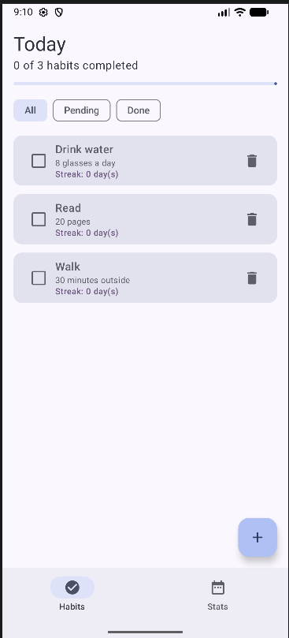
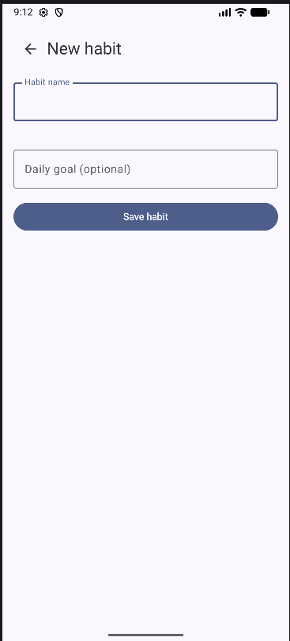
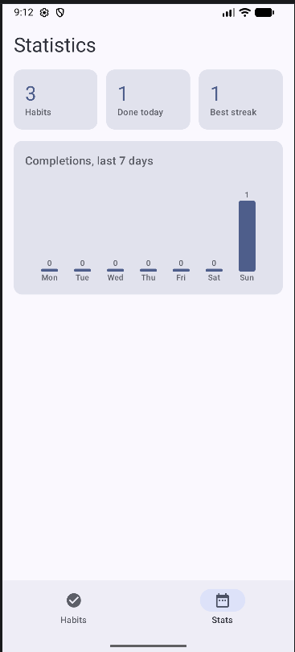

# HabitTracker

HabitTracker is an Android habit tracker built with Kotlin, Jetpack Compose and Material 3.

## Features

1. **Daily checklist**: add habits with a name and a goal, tick them off for today, and see overall progress in a progress bar.
2. **Streaks and filtering**: every habit shows its current streak of consecutive days. Filter between All, Pending and Done.
3. **Statistics**: total habits, habits done today, best streak, and a bar chart of completions for the last 7 days.
4. **Safe editing**: input validation on the add form, a confirmation dialog before deleting, and snackbar feedback after changes.

## Screenshots

| Habits | Add habit | Statistics |
|---|---|---|
|  |  |  |

1. **Habits screen** (`screenshots/habits.png`): the "Today" header with "1 of 3 habits completed" and a progress bar, the All / Pending / Done filter chips, and habit cards. Each card has a checkbox, the habit name and goal, a streak counter and a delete icon. A floating "+" button is in the bottom corner and the bottom navigation bar highlights "Habits".
2. **Add habit screen** (`screenshots/add_habit.png`): a back arrow with the "New habit" title, a "Habit name" text field showing the red "Name cannot be empty" error after pressing Save with an empty name, an optional "Daily goal" field, and a full-width "Save habit" button. The bottom bar and FAB are hidden here.
3. **Statistics screen** (`screenshots/stats.png`): three stat cards (Habits, Done today, Best streak) above a card titled "Completions, last 7 days" with seven vertical bars labelled by weekday, each topped by its count. The "Stats" tab is highlighted in the bottom bar.

## Architecture

- `model/`: `Habit` data class (with streak logic) and `HabitFilter` enum.
- `data/`: `HabitRepository` holds the habits in a `MutableStateFlow` and exposes read-only `StateFlow`.
- `ui/HabitViewModel.kt`: combines repository data and the selected filter into one `HabitUiState` exposed as `StateFlow`. A `SharedFlow` carries one-off snackbar messages.
- `ui/screens/` and `ui/components/`: stateless screens and reusable composables (`StatCard`, `FilterRow`, `HabitCard`).
- `navigation/HabitApp.kt`: `NavHost`, bottom navigation, FAB, and lifecycle-aware collection with `collectAsStateWithLifecycle` and `repeatOnLifecycle`.

State handling: UI state is hoisted to the ViewModel and screens receive state and callbacks. Form fields and the delete dialog use `rememberSaveable`, so they survive rotation. The ViewModel survives configuration changes, so habits and the selected filter are kept.

## Running

1. Install Android Studio (Koala or newer).
2. Clone the repository and choose **File > Open** on the project folder.
3. Wait for Gradle sync (Android Studio creates the Gradle wrapper files if missing).
4. Select an emulator or device running Android 8.0 (API 26) or higher and press **Run**.

Note: data is kept in memory, so it resets when the app process is killed.